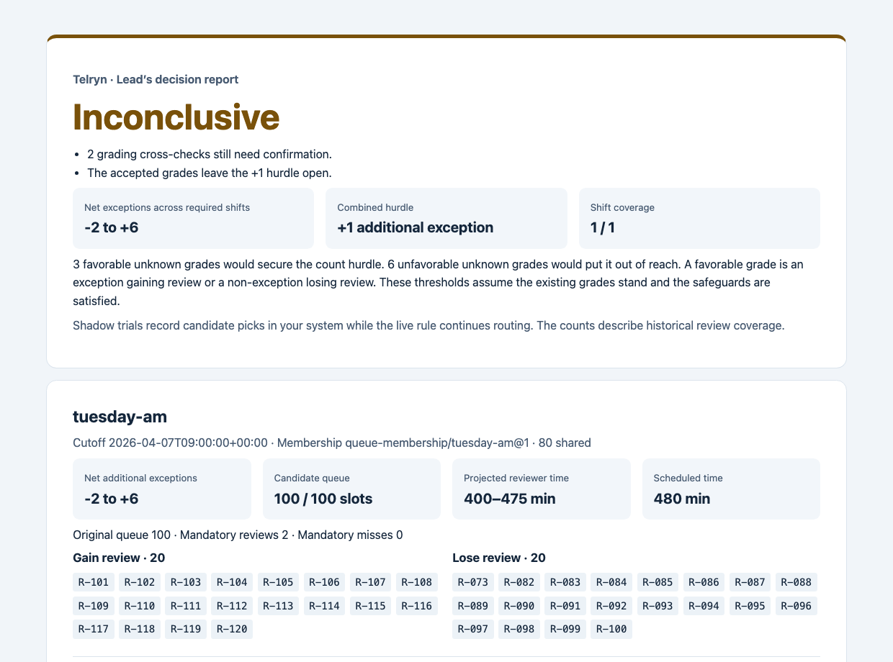

# Telryn

**See who gains and loses human review before you change a queue rule.**

Both rules fill 100 refund review slots. They send 20 different requests to
review. Does the change catch more exceptions, preserve mandatory reviews, and
fit the shift?

Telryn replays a scheduled queue at its historical cutoff, compares two frozen
rules, and gives the operations lead an offline HTML report and the reviewer a
separate grading CSV. When evidence is incomplete, the report shows how far
the answer can move and which judgments could settle it.

[](https://github.com/davidahma/telryn/actions/workflows/ci.yml)
[](LICENSE)

## Run the demo

Download the [latest release](https://github.com/davidahma/telryn/releases/latest)
or clone the repository. From the unpacked directory or checkout, run:

```sh
python3 -m telryn demo
```

Use CPython 3.12 or newer with SQLite support on macOS or Linux. The demo and
qualification suite run offline with Python installed. There are no Python
packages to install, and the bundled refund data is synthetic.

The terminal prints the three scenarios and the paths to the Tuesday files.
Open `report.html` in a browser. Give the reviewer only `grading.csv` and access
to the permitted evidence revisions. For a named output directory, pass
`--out runs/demo` on the first run.



## Work through Tuesday

The two rules share 80 requests. Ten exceptions lose review. Eight confirmed
exceptions gain it, and eight gains have unknown grades. That leaves the net
change between **−2 and +6**. Three new positive grades meet the **+1** hurdle
if the existing grades stand. Six negatives put the hurdle out of reach.

| Recommendation | What the lead can do |
| --- | --- |
| **Hold** | Stop on a verified mandatory-review, capacity, or staffing failure, or when the supported count rules out the hurdle. |
| **Inconclusive** | Resolve the missing shift, grade, cross-check, or workload evidence named in the report. |
| **Try in shadow** | Record candidate picks in your existing system while the live rule continues routing. |

```sh
python3 -m telryn compare examples/refunds/comparison.toml --out runs/tuesday
python3 -m telryn explain runs/tuesday/report.html
```

Follow the [refund walkthrough](docs/refund-walkthrough.md) to inspect exact
evidence revisions, return a partially filled CSV, and refresh the decision.
The [plain SQLite comparison](docs/refund-walkthrough.md#compare-with-plain-sql)
uses the same synthetic evidence so you can inspect what Telryn adds.

## Bring your own queue

Start with a scheduled queue that resets between batches. You'll need the
original ordered picks, a separately recorded eligible population, exact
cutoff inputs, the live rule and override history, a shared grading rubric,
and staffing limits. A matching list of historical winners can hide a missing
eligible request. Telryn reconciles membership before scoring a candidate.

Read the [comparison and export reference](docs/comparison.md) for the
format, selector contract, supported overrides, grade handling, and CLI exit
codes. Keep local selector code trusted and the lead report private. Queues
with carryover or continuous reassignment need a different replay model.

## Verify the release

```sh
python3 -m telryn qualify
python3 -m telryn qualify --case grade-return
```

The suite checks cutoff replay, exact bounds, workload and capacity, coverage,
blind grading, concurrent returns, interruption recovery, and stable case
results across fresh processes. The [release notes](https://github.com/davidahma/telryn/releases)
record which configurations passed. The published example measures historical
review coverage. Operational time savings and customer outcomes require field
evidence.

[Contribute](CONTRIBUTING.md) · [Security](SECURITY.md) · [Apache-2.0](LICENSE)
