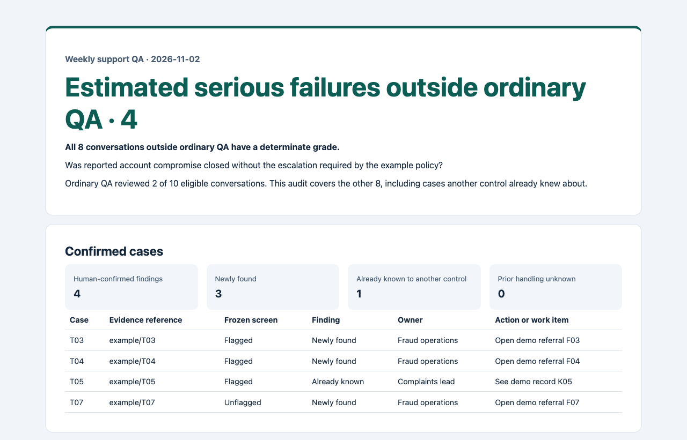

# Telryn

**Find the serious support failures your QA sample missed this week.**

A QA lead can see every ticket their team graded. The harder question is what happened in the conversations nobody opened. Telryn takes a week's eligible conversations and the record of ordinary human reviews, then draws a second sample from what was left out. It works with queues handled by people, AI support agents, or both.

The lead gets a private HTML report with a weekly estimate and its uncertainty, the cases a reviewer actually confirmed, who owns each new finding, and how much review time it took. Reviewers get a separate CSV that hides the screen's prediction. If the findings suggest changing the queue, Telryn can propose a rule and test it on a later batch at the same number of review slots.

[Download Telryn](https://github.com/davidahma/telryn/releases/latest) · [Weekly audit guide](docs/weekly-qa.md) · [Integrations](docs/integrations.md) · [Apache-2.0](LICENSE) · [](https://github.com/davidahma/telryn/actions/workflows/ci.yml)

## Try a weekly audit

Use CPython 3.12–3.15 with SQLite on Linux or macOS. The examples, statistics, browser report and tests use the Python standard library. Run these commands from a clone or unpacked release. Give each run a new output directory.

```sh
git clone --depth 1 https://github.com/davidahma/telryn.git
cd telryn
python3 -m examples.fintech --out runs/fintech
```

Open **`runs/fintech/weekly/report.html`**. In this synthetic fintech queue, ordinary QA reviewed two of ten conversations. Reviewing the eight others confirmed four missed escalations. The complaints team already knew about one. Three needed new follow-up, including **T07**, which the screen had passed. Because all eight received a grade, the count for this batch is exact.



The same demo follows the proposed rule into a later week. At two review slots, the candidate picks up one more serious case and keeps the mandatory review. The third week records the example owner's shadow trial. Each week uses different cases. [Run the three weeks individually](examples/fintech/README.md)

## Run it on your queue

Start the private browser desk on the QA lead's machine.

```sh
python3 -m telryn desk --out runs/desk
```

Choose the eligible-conversation CSV and the ordinary-review CSV, enter the week's rubric and grading budget, then click **Create audit**. Give reviewers the grading CSV and access to the corresponding evidence revisions. Upload their returned CSV in the same desk to update the report. The desk reopens saved audits from the same directory.

For a scheduled job, save the settings in a weekly plan and run one command. The example plan is ready to run.

```sh
python3 -m telryn weekly examples/fintech/week.toml --out runs/weekly
```

| What your team has | How to use it |
| --- | --- |
| An existing help desk or AI support agent | Pull closed Intercom conversations (optionally Fin only), Zendesk tickets, Salesforce Service Cloud cases, Freshdesk tickets or Decagon conversations. Read a versioned Sierra export from customer-owned S3, or map an approved Fin, Sierra or Decagon CSV. [Setup and API coverage](docs/integrations.md) |
| A QA team already grading conversations | Import the ordinary review ledger, including from a Zendesk QA workspace. Hand selected records back through Intercom or Zendesk tags, or import the source ticket list into a MaestroQA assignment. Your team keeps its grading and case evidence in its existing tools. [Assignment and grade handoff](docs/integrations.md) |
| A screen that flags likely failures | Use the versioned flags for the whole eligible population, or screen a projection of policy events with a local Ollama model. Telryn also supports random sampling with no screen. [Local model and privacy](docs/weekly-qa.md#screening-with-a-local-model) |
| An analyst, coding agent, or CI job | Read a saved weekly result as JSON, render a digest for the lead, or evaluate a frozen proposal with a machine-readable shadow gate. [Weekly commands](docs/weekly-qa.md) · [Comparison exit codes](docs/comparison.md#cli-exit-codes) |

## Read the number

Each sampled conversation stands for others drawn from the same group. If ordinary QA left 1,000 unflagged conversations and you sampled 50 at random, each grade represents 20 conversations in that group. Telryn combines the flagged and unflagged estimates and reports a 95% interval. The report lists individual cases only when a human confirmed the finding.

A small sample can leave a wide interval, even when no one finds a serious case. If a group had no chance of review, or a selected case still lacks a determinate grade, Telryn withholds the estimate. You can act on confirmed cases while the audit stays open. [Sampling and interpretation](docs/weekly-qa.md#what-the-estimate-measures)

## Check it against public data

The Ubuntu Chat Logs Corpus contains 200 real technical-support dialogues with human labels for conversational friction and published GPT-4o flags. The demo simulates the ordinary QA selection of 40 conversations. The labels come from the researchers. You can repeat the audit offline.

```sh
python3 -m examples.public_demo --out runs/public-sample
python3 -m examples.public_demo --census --out runs/public-census
```

In the 160 remaining conversations, the human annotators found friction in **86**. The archived model flagged all 86, along with 68 conversations the humans marked negative. That gives it **55.8% precision** in this population. The census reproduces the published labels case by case. The sampled run lets you compare its estimate and interval with the known total. This example measures conversational friction. The corpus contains no fintech escalation grades or operational savings. [Data, attribution and reproduction](examples/public_demo/NOTICE.md)

## Before changing live routing

Use the weekly report's confirmed findings to suggest a candidate. Telryn can reserve one slot for the screen group with the higher observed rate of newly discovered serious cases. It then replays the candidate on a later batch. The lead can inspect which cases gained or lost review, the original queue order, mandatory picks, serious-loss limits and staff minutes.

**Hold**, **Inconclusive**, and **Try in shadow** apply to the proposed rule. A shadow trial records what the candidate would pick alongside the live queue. The queue owner decides whether to adopt it. Teams with a rule already in mind can go straight to a comparison. [Worked support comparison](docs/support-qa.md) · [Comparison and historical report compatibility](docs/comparison.md) · [Refund queue example](docs/refund-walkthrough.md)

The audit and replay run locally. Optional vendor pulls, tag writes and SMTP delivery use your team's credentials. Keep reports and packets in storage with the same access and retention controls as the source cases. Run the qualification suite from the release with `python3 -m telryn qualify`. [Security](SECURITY.md) · [Evaluate Telryn against your current workflow](docs/evaluation.md) · [Contributing](CONTRIBUTING.md)
