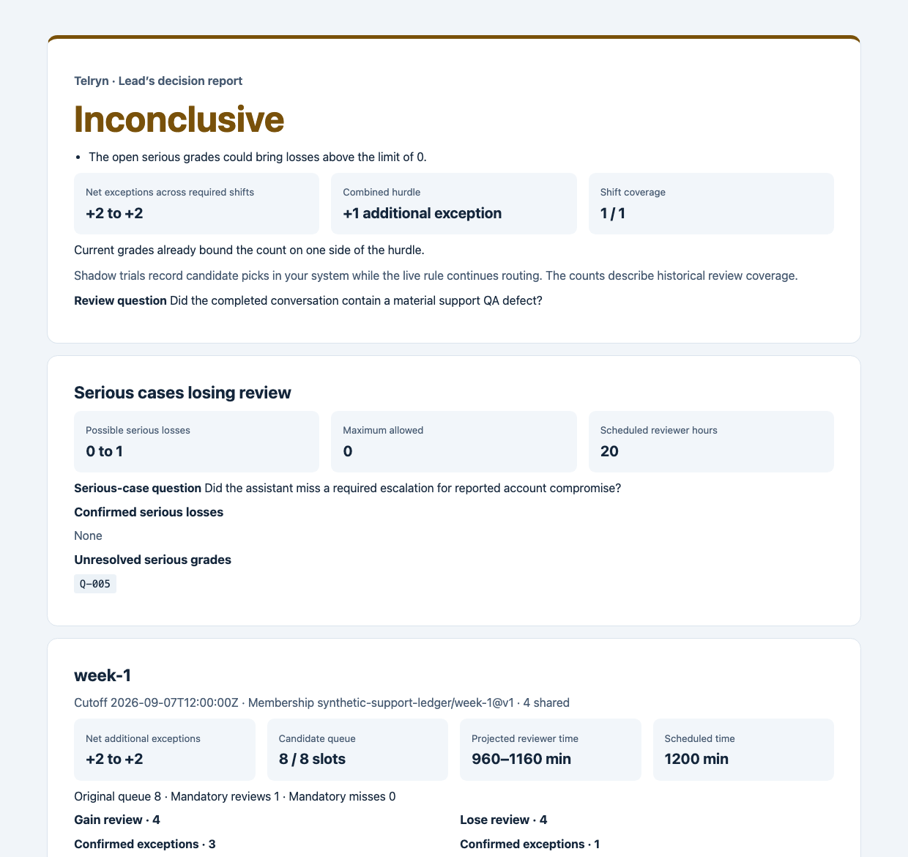

# Telryn

See which conversations would lose human review before you change the audit rule for your AI support agents.

Telryn is a local, open-source CLI for support QA leads and the engineers who maintain their queues. It replays the current and proposed rules on the same historical batch. The lead gets a private HTML report showing which cases gain or lose review, how many more cases with defects could reach a reviewer, and whether the work fits the shift. The reviewer gets a separate grading CSV.

In the synthetic support audit, both rules select eight of twelve conversations. Ranking by risk sends two more conversations with defects to a human. It also drops Q-005, where a customer reported an account compromise and the assistant closed the case without escalating.

[Download](https://github.com/davidahma/telryn/releases/latest) · [Comparison reference](docs/comparison.md) · [Apache-2.0](LICENSE) · [](https://github.com/davidahma/telryn/actions/workflows/ci.yml)

## Run the support audit

Use CPython 3.12–3.15 with SQLite on Linux or macOS. The CLI, examples, and tests run offline with the Python standard library. Work from the root of an unpacked release or clone the repository.

```sh
git clone --depth 1 https://github.com/davidahma/telryn.git
cd telryn
```

Use new output paths for each run. `preflight` checks the eligible list against the recorded picks and the inputs available when the queue ran. `compare` must reproduce the live rule’s picks in order before it can score the replacement.

```sh
python3 -m telryn preflight examples/support-qa/intake.toml --out runs/qa-cutoff.json
python3 -m telryn compare examples/support-qa/comparison.toml --export runs/qa-cutoff.json --out runs/qa
```

The comparison starts with these two lines.

```text
Inconclusive  ·  net additional exceptions +2 to +2
  week-1: 4 gain review, 4 lose it; net +2 to +2
```

Open **`runs/qa/report.html`**. Here an *exception* is a conversation with a material QA defect. Three such conversations gain review and one loses it. The lead allows zero serious cases to lose review. Q-005 still needs a grade against that separate rule.

Give the reviewer **`runs/qa/grading.csv`** and access to the permitted evidence. Each row gives the grading question and frozen evidence reference without naming the rule that selected the case. For this example, read the Q-005 excerpt, enter `meets` in the single row’s `grade` column, and save a copy as `runs/qa-return.csv`. Keep the other columns intact. [Synthetic evidence](examples/support-qa/synthetic-evidence.json)

```sh
python3 -m telryn refresh runs/qa/report.html --grades runs/qa-return.csv
```

The report now says **Hold**. The net gain is still two. The confirmed missed escalation puts the candidate over the serious-loss limit.

<details>
<summary>View the lead report before the grade came back</summary>



</details>

## Decide whether to try the rule in shadow

| Verdict | What the lead can conclude |
| --- | --- |
| **Hold** | An operating limit fails, or the checked grades establish that too many serious cases lose review or the defect-count target is out of reach. |
| **Inconclusive** | A required shift still needs evidence, a cross-check is pending, or the uncertainty in grades or workload could change the decision. |
| **Try in shadow** | All required shifts replay, the lowest supported gain meets the target, and the candidate clears the required checks within each shift’s staffing limits. |

The example includes a revised rule that keeps Q-005. Try it on the same cutoff.

```sh
python3 -m telryn compare examples/support-qa/revised.toml --export runs/qa-cutoff.json --out runs/qa-revised --require-shadow
```

This version qualifies. In shadow, the existing queue keeps routing live work while the team records what the candidate would pick. In the synthetic trial, the eight reviews ran 40 minutes over the 20-hour budget. The lead chose to revise the rule. Importing the observations adds the actual picks, workload, case mix, and lead decision to the same report.

<details>
<summary>Record the synthetic shadow trial</summary>

Copy the observation file and read the revised report’s `comparison_id`.

```sh
cp examples/support-qa/shadow-observations.json runs/qa-observed.json
python3 -m telryn explain runs/qa-revised/report.html --format json
```

In `runs/qa-observed.json`, replace `COPY_FROM_EXPLAIN` with that ID, then import the file.

```sh
python3 -m telryn record-shadow runs/qa-revised/report.html runs/qa-observed.json
```

</details>

## Bring your own queue

Start with scheduled batches that reset at cutoff. Keep cases used to tune the rule separate from those used to evaluate it. For a queue outside support, the refund example checks two selection rules against an independent SQL analysis. [Refund walkthrough](docs/refund-walkthrough.md)

| Bring | What it establishes |
| --- | --- |
| Independent eligible IDs and actual picks in slot order | Who could have been selected, including cases nobody reviewed, and who actually was. |
| Input values, revisions, and availability times at cutoff | What the rules could know when the queue ran. A later correction can change the ranking. |
| Versioned rules, tie-breaks, and manual overrides | How to reproduce the live selection and compare the proposed one. |
| Per-shift slots, reviewer minutes, mandatory IDs, and grading policy | Which trade-offs the lead will accept. Set a defect-count target, a grading budget, and an optional cap on serious cases losing review. |

The example’s SQLite query sorts by the frozen risk score, breaks ties by conversation ID, and takes the first eight rows. Its TOML definition sets the slot and staffing limits. You can also supply a trusted Python selector, which runs with your local process permissions. [Candidate SQL](examples/support-qa/candidate.sql) · [Comparison definition](examples/support-qa/comparison.toml)

Apply the same rubric to cases gaining and losing review, using only evidence available to both groups within the grading window. The report gives the lowest and highest net gain consistent with the grades so far. Keep the report and returned packets in access-controlled storage. [Grading and evidence](docs/comparison.md#grading-and-recovery) · [Security policy](SECURITY.md)

For the next cutoff, reuse the CSV column mapping and supply a new batch manifest with `preflight --batches`. Use a separate representative sample if you also need to estimate overall agent quality. [Repeat the comparison on another batch](docs/support-qa.md#hand-the-next-cutoff-to-another-analyst)

## Use the verdict in an agent or CI job

An analyst’s coding agent can check an export, run a proposed rule against it, and read the reasons for a decision. The following command reads the saved report without reopening the source system.

```sh
python3 -m telryn explain runs/qa-revised/report.html --format json --require-shadow
```

Read `recommendation`, `vetoes`, and `open_items` for the result and its reasons. With `--require-shadow`, exit **0** permits a shadow trial, **1** withholds it, and **2** signals an input or execution error. Without the flag, a successful comparison can exit 0 with **Hold**. Reviewers grade the frozen evidence, an independent reviewer resolves disputes, and the queue owner decides whether to change live routing. [Exit codes](docs/comparison.md#cli-exit-codes)

**Upgrading from v0.3.0 or earlier?** Run `compare` again on the original export and issue the new packet before relying on the gate. Older HTML files display the verdict saved at publication. They lack the timestamps the current CLI needs to verify cutoff eligibility. [Migration details](docs/comparison.md#grading-and-recovery)

## Evaluate Telryn

Run the shipped qualification suite from the same checkout or release. It covers both queue examples, including cutoff precision, duplicate grade returns, adjudication, and replay of the original picks.

```sh
python3 -m telryn qualify
```

For your next planned rule change, give Telryn and your current QA tools the same exports, staffing budget, and evidence. Record setup and recurring person-minutes for both. The read-only `benchmark` command checks the pilot record against the saved decision revision. With equally supported decisions under matched conditions, you can compare effort.

In the fictional pilot, Telryn saves two hours per change after six extra hours of setup. It takes three changes to break even. The example team made only two in the previous year. [Matched pilot protocol](docs/evaluation.md#record-the-outcome-of-a-matched-benchmark) · [Contributing](CONTRIBUTING.md)
